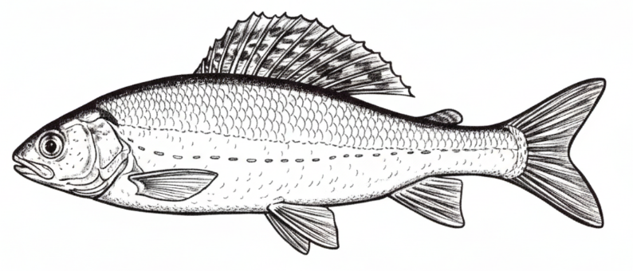
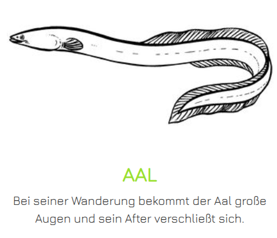
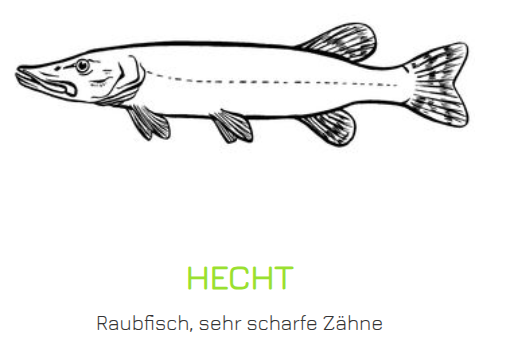
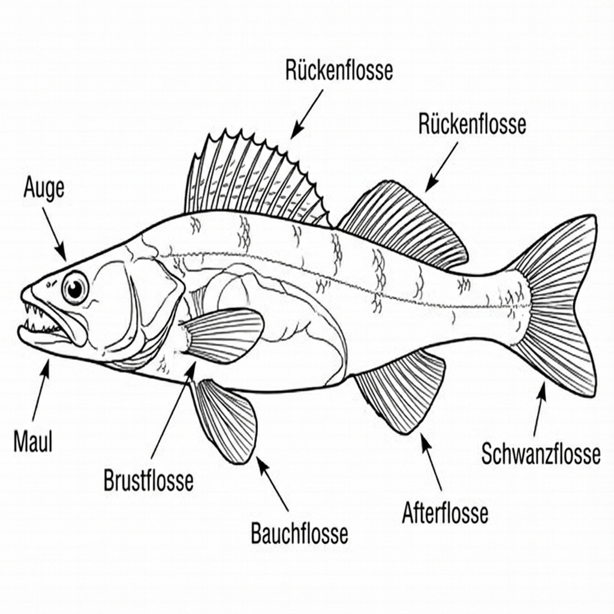
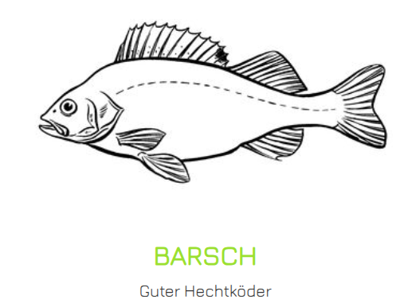
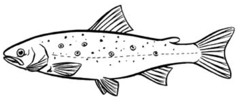
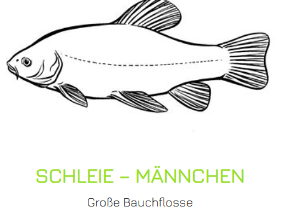
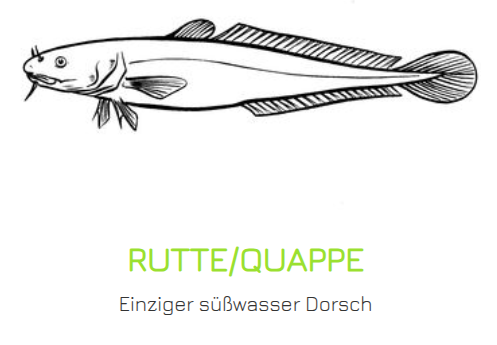
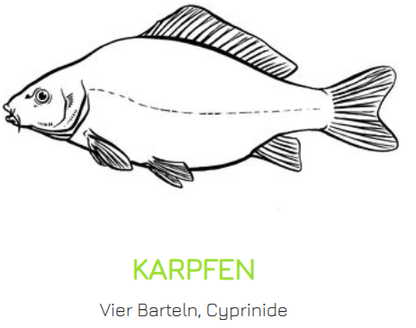
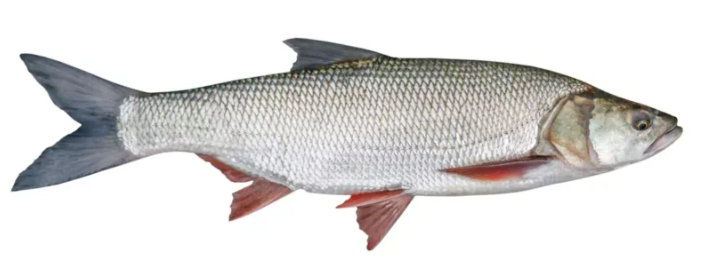

# Gesetzeskunde - Rechtliche Grundlagen des Angelns

Das Angeln in Deutschland ist umfassend durch Gesetze und Verordnungen geregelt. 
Diese Regelungen dienen dem Schutz der Fischbestände, der Gewässer, der Natur und der Einhaltung tierschutzrechtlicher Grundsätze.

**Wichtiger Hinweis:** Die Fischereigesetzgebung ist Ländersache!

## Das Fischereirecht - Grundlagen

### Was ist das Fischereirecht?

Das Fischereirecht ist das Recht, in einem Gewässer zu fischen.
In Deutschland gibt es kein "freies Angelrecht" - jedes Gewässer gehört jemandem, und nur der Inhaber des Fischereirechts darf dort fischen oder anderen die Erlaubnis dazu geben.

### Arten des Fischereirechts

**Eigentümerfischereirecht:**
Der Grundstückseigentümer besitzt automatisch das Fischereirecht an Gewässern auf seinem Grundstück.

**Gilt für:**
- Private Teiche
- Kleine Bäche
- Gewässer auf Privatgrundstücken

**Pachtfischereirecht:**
Das Fischereirecht wird vom Eigentümer an einen Pächter verpachtet. 
Dieser kann dann angeln oder weitere Erlaubnisse vergeben.

**Gemeinschaftliches Fischereirecht:**
In einigen Regionen haben Anlieger an Gewässern gemeinschaftliche Fischereirechte.

**Staatliches Fischereirecht:**
An großen Flüssen und Gewässern kann das Fischereirecht beim Staat liegen.

### Wichtig zu verstehen:

**Fischereirecht ≠ Grundstückseigentum**

Nur weil ein Gewässer auf öffentlichem Grund liegt, heißt das nicht, dass dort jeder angeln darf.
Auch wenn du am Ufer stehst, brauchst du die Erlaubnis des Fischereirechtsinhabers!

## Der Fischereischein (Angelschein)

### Rechtsgrundlage

In Deutschland ist der Fischereischein grundsätzlich Pflicht zum Angeln.
Die Regelungen finden sich in den Fischereigesetzen der Bundesländer.

### Voraussetzungen

**Fischerprüfung:**
In fast allen Bundesländern muss vor dem Erwerb des Fischereischeins eine Fischerprüfung abgelegt werden.

**Prüfungsinhalte:**
- Allgemeine Fischkunde
- Spezielle Fischkunde
- Gewässerkunde
- Natur- und Tierschutz
- Gerätekunde
- Gesetzeskunde

In Hamburg ist das Mindestalter für den Fischereischein 12 Jahre.

### Arten des Fischereischeins

**Fischereischein auf Lebenszeit:**
- Einmalige Prüfung
- Schein gilt lebenslang
- In den meisten Bundesländern Standard
- Gebühr bei Ausstellung und Verlängerung

**Jahresfischereischein:**
- Muss jährlich verlängert werden
- Fischereiabgabe wird jährlich fällig

**Jugendfischereischein:**
- Für Kinder und Jugendliche
- Teilweise ohne Prüfung
- Oft nur in Begleitung eines erwachsenen Fischereischeininhabers
- Altersgrenzen variieren

**Sonderfischereischein:**
- Für Menschen mit Behinderungen
- Regelungen unterschiedlich

**Ausnahmeregelungen:**
Einige Bundesländer bieten zeitlich begrenzte Scheine ohne Prüfung an:
- Touristenfischereischein (z.B. Mecklenburg-Vorpommern, 28 Tage)
- Vierteljahresschein (z.B. Brandenburg, mit Abgabe ohne Prüfung)

### Gültigkeit

Der Fischereischein gilt normalerweise nur in dem Bundesland, in dem er ausgestellt wurde. **ABER:** Er wird in anderen Bundesländern in der Regel anerkannt, wenn man dort angeln möchte.

**Wichtig:**
- Fischereischein immer beim Angeln mitführen!
- Bei Kontrolle vorzeigen
- Verlust oder Beschädigung melden und Ersatz beantragen

## Der Fischereierlaubnisschein (Angelkarte, Gastkarte)

### Zwei Dokumente sind Pflicht!

Zusätzlich zum Fischereischein benötigst du für jedes Gewässer einen **Fischereierlaubnisschein**.
Erst beide zusammen berechtigen zum Angeln.

**Fischereischein:** Berechtigung der Person (du darfst angeln)
**Erlaubnisschein:** Berechtigung für das Gewässer (du darfst HIER angeln)

### Gewässerordnung

Zum Erlaubnisschein gehört meist eine **Gewässerordnung** - ein Regelwerk für das jeweilige Gewässer.

**Typische Inhalte:**
- Erlaubte Angelmethoden
- Verbotene Bereiche (Schutzzonen, Laichschonbezirke)
- Anzahl der Ruten
- Schonzeiten und Mindestmaße (können strenger sein als gesetzliche!)
- Entnahmebeschränkungen (z.B. max. 3 Karpfen pro Tag)
- Nachtangelverbot oder -erlaubnis
- Anfütterregeln
- Verhalten am Gewässer

**Wichtig:** Die Gewässerordnung genau lesen und einhalten! Verstöße können zum Ausschluss führen.

## Schonzeiten und Schonmaße

Schonzeiten und Mindestmaße dienen dem Schutz der Fischbestände.

### Schonzeiten

Schonzeiten sind Zeiträume, in denen bestimmte Fischarten nicht beangelt werden dürfen.
Dies dient dem Schutz während der Laichzeit, damit sich Fische ungestört fortpflanzen können.
Gefangene Fische während der Schonzeit müssen sofort schonend zurückgesetzt werden

**Beispiele:**
- **Hecht**: Meist Februar bis April
- **Zander**: April bis Mai
- **Forelle**: Oktober bis Februar

**Ganzjährige Schonzeit:**
Manche Arten sind ganzjährig geschützt und dürfen nie entnommen werden:
- Stör
- Regional: Nase, Äsche, Lachs

### Mindestmaße (Schonmaße)

Mindestlänge, die ein Fisch haben muss, damit er entnommen werden darf.
Dies soll sicherstellen, dass sich Fische mindestens einmal fortpflanzen können, bevor sie entnommen werden.
Die Messung erfolgt von der Maulspitze bis zum Ende der Schwanzflosse.
Untermaßige Fische MÜSSEN sofort und schonend zurückgesetzt werden.

**Beispiele (variieren stark!):**
* **Hecht**: 45-75 cm
* **Zander**: 45-75 cm
* **Aal**: 45-75 cm
* **Forelle**: 20-40 cm
* **Meeresforelle**: 20-40 cm
* **Karpfen**: 35-* cm

### Entnahmefenster / Höchstmaße

In einigen Gewässern gelten zusätzlich **Höchstmaße** oder **Entnahmefenster**:

**Beispiel:**
- Hecht: Entnahme nur zwischen 50-80 cm erlaubt
- Kleinere und größere Fische müssen zurückgesetzt werden

**Zweck:**
- Schutz der Laichfische (große, alte Fische sind besonders produktiv)
- Erhaltung der Altersstruktur

### Hamburg Regeln:

| Fischart | Unteres Maß | Oberes Maß | Tageshöchstmenge | Schonzeit | Bildreferenz |
| :--- | :--- | :--- | :--- | :--- | :--- |
| **Äsche** |  |  | - | 01.01.15.05 | {width=10%} |
| **Aal** | 45 cm | 75 cm | 3 Expl. | - | {width=10%} |
| &nbsp; | &nbsp; | &nbsp; | &nbsp; | &nbsp; | &nbsp; |
| **Hecht** | 45 cm | 75 cm | 2 Expl. | 01.02. - 31.05. | {width=10%} |
| &nbsp; | &nbsp; | &nbsp; | &nbsp; | &nbsp; | &nbsp; |
| **Zander** | 45 cm | 75 cm | 2 Expl. | 01.02. - 31.05. | {width=10%} |
| &nbsp; | &nbsp; | &nbsp; | &nbsp; | &nbsp; | &nbsp; |
| **Flussbarsch** | 10 cm | 35 cm | - | - | {width=10%} |
| &nbsp; | &nbsp; | &nbsp; | &nbsp; | &nbsp; | &nbsp; |
| **Bachforelle** | 20 cm | 40 cm | - | 15.10. - 15.02. | {width=10%} |
| &nbsp; | &nbsp; | &nbsp; | &nbsp; | &nbsp; | &nbsp; |
| **Schleie** | 25 cm | 45 cm | - | - | {width=10%} |
| &nbsp; | &nbsp; | &nbsp; | &nbsp; | &nbsp; | &nbsp; |
| **Quappe** | 30 cm | 50 cm | 3 Expl. | - | {width=10%} |
| &nbsp; | &nbsp; | &nbsp; | &nbsp; | &nbsp; | &nbsp; |
| **Karpfen** | 35 cm | kein oberes Maß | - | - | {width=10%} |
| &nbsp; | &nbsp; | &nbsp; | &nbsp; | &nbsp; | &nbsp; |
| **Meerforelle** | 40 cm | 65 cm | 2 Expl. | 15.10. - 15.02. | |
| &nbsp; | &nbsp; | &nbsp; | &nbsp; | &nbsp; | &nbsp; |
| **Rapfen** | 50 cm | 70 cm | 1 Expl. | - | {width=10%} |

## Verbote und Gebote

### Allgemeine Verbote

**Schwarzangeln:**
Angeln ohne gültigen Fischereischein und/oder Erlaubnisschein ist strafbar!

**Strafrahmen:**
- Geldstrafe oder Freiheitsstrafe bis zu 2 Jahren
- Einzug des Angelgeräts
- Fischereiverbot

**Fischen mit verbotenen Mitteln:**
- Sprengstoff, Gift, Strom (außer behördlich genehmigtes Elektrofischen)
- Waffen (Harpunen, Pfeile)
- Reusen ohne Genehmigung
- Netze (Berufsfischerei)

**Nachstellung geschützter Arten:**
Das gezielte Beangeln ganzjährig geschützter Fischarten ist verboten.

**Lebende Wirbeltiere als Köder:**
In den meisten Bundesländern verboten. Lebende Köderfische sind nicht erlaubt!

**Tierquälerei:**
- Unsachgemäße Behandlung von Fischen
- Nicht waidgerechte Tötung
- Zurücksetzen verletzter Fische ohne vernünftigen Grund

### Gebote

**Fischereiausübungspflicht (Hege):**
Wer ein Fischereirecht besitzt oder pachtet, hat die Pflicht zur Hege:
- Artgerechter Besatz
- Gewässerpflege
- Überwachung
- Schädlingsbekämpfung

**Fangbuch / Fangstatistik:**
Manche Bundesländer oder Gewässer verlangen die Führung eines Fangbuchs zur Dokumentation der Fänge.

**Mitführpflicht:**
Fischereischein und Erlaubnisschein müssen beim Angeln mitgeführt und auf Verlangen vorgezeigt werden.

**Verwertungspflicht:**
Entnommene Fische sollen verwertet (gegessen) werden. Wegwerfen ist nicht erlaubt.

## Fischereiaufsicht

### Wer darf kontrollieren?

**Fischereiaufseher:**
- Vom Fischereirechtinhaber bestellte Personen
- Haben umfangreiche Kontrollrechte
- Tragen oft Dienstausweis oder Armbinde

**Fischereibehörden:**
- Beamte der unteren Fischereibehörde

**Polizei:**
- Allgemeine Kontrollbefugnisse

### Rechte der Fischereiaufsicht

**Kontrollbefugnisse:**
- Überprüfung von Fischereischein und Erlaubnisschein
- Kontrolle der Fänge
- Kontrolle des Angelgeräts
- Überprüfung von Schonzeiten und Mindestmaßen
- Feststellung der Personalien

**Bei Verstößen:**
- Platzverweis
- Anzeige bei Behörden
- Einzug von Fanggeräten
- Entzug des Erlaubnisscheins

### Pflichten des Anglers bei Kontrolle

**Verhalten:**
- Ruhig und respektvoll bleiben
- Ausweis vorzeigen (Fischereischein, Erlaubnisschein, Personalausweis)
- Fänge zeigen
- Angaben machen

**Wichtig:**
- Fischereiaufseher haben Recht auf Kontrolle
- Verweigerung kann Konsequenzen haben
- Bei Unklarheiten höflich nachfragen

## Strafbestimmungen

### Fischwilderei (Straftat)

**§ 293 StGB - Fischwilderei:**
Wer unter Verletzung fremden Fischereirechts oder Fischereiausübungsrechts fischt, wird mit Freiheitsstrafe bis zu zwei Jahren oder Geldstrafe bestraft.

**Das bedeutet:**
Angeln ohne Erlaubnis ist kein Kavaliersdelikt, sondern eine **Straftat**!

**Strafrahmen:**
- Geldstrafe (Tagessätze)
- Im Wiederholungsfall oder schweren Fällen: Freiheitsstrafe
- Eintragung ins Führungszeugnis möglich

### Ordnungswidrigkeiten

Viele Verstöße gegen Fischereigesetze sind Ordnungswidrigkeiten:

**Beispiele:**
- Angeln ohne Fischereischein (in manchen Bundesländern)
- Verstöße gegen Schonzeiten
- Entnahme untermaßiger Fische
- Verstöße gegen Gerätebeschränkungen
- Nichteinhaltung von Gewässerordnungen

**Bußgelder:**
- Je nach Verstoß und Bundesland: 50 € bis 5.000 €
- Bei schweren Verstößen höher

### Verwaltungsrechtliche Konsequenzen

**Entzug des Fischereischeins:**
Bei groben oder wiederholten Verstößen kann der Fischereischein entzogen werden.

**Ausschluss aus Angelverein:**
Verstöße gegen Gewässerordnung können zum Vereinsausschluss führen.

## Besondere Regelungen

### Nachtangeln

**Regelungen variieren stark:**
- Manche Gewässer erlauben Nachtangeln
- Andere verbieten es generell
- Teilweise Genehmigung erforderlich
- Schutzzonen oft nachts gesperrt

**Immer in der Gewässerordnung nachschauen!**

### Bootsangeln

**Grundsätzlich erlaubt, ABER:**
- Schifffahrtsregeln beachten
- Rettungsweste oft Pflicht
- Manche Gewässer verbieten Bootsangeln
- Motor-Regelungen beachten
- Nicht in Schutzzonen fahren

### Eisangeln

**Wo erlaubt:**
- Nur auf sicher gefrorenen Gewässern
- Oft spezielle Regelungen
- Manche Gewässer verbieten Eisangeln

**Sicherheit geht vor:**
- Eisdicke mindestens 15 cm
- Nie alleine aufs Eis
- Sicherheitsausrüstung

### Gemeinschaftsangeln / Wettangeln

**Regelungen:**
- Oft Genehmigung erforderlich
- Tierschutzrechtliche Bedenken bei reinen Wettangeln
- Hegefischen zur Gewässerpflege erlaubt

## Weitere relevante Gesetze

### Tierschutzgesetz

Wie bereits im Kapitel Natur- und Tierschutz behandelt:
- Fische sind Wirbeltiere und geschützt
- Kein Tier darf ohne vernünftigen Grund leiden
- Waidgerechte Behandlung ist Pflicht

### Naturschutzgesetz

**Regelungen:**
- Schutz von Naturschutzgebieten
- Verbot, geschützte Arten zu stören
- Betretungsverbote beachten
- Brutzeiten respektieren

### Wasserrecht

**Gewässernutzung:**
- Gewässer sind öffentliches Gut
- Gemeingebrauch (Baden, Schwimmen) vs. Sondernutzung (Angeln)
- Gewässerreinhaltung
- Einleitungsverbote

### Landeswaldgesetz / Betretungsrecht

**Uferzugang:**
- Privatgrundstücke dürfen nicht betreten werden
- Öffentliche Wege nutzen
- Auch wenn ein Gewässer beangelt werden darf, heißt das nicht, dass jedes Ufer betreten werden darf

## Bundesländer-Spezifika

Da Fischereirecht Ländersache ist, gibt es erhebliche Unterschiede:

### Beispiele für Unterschiede:

**Bayern:**
- Fischerprüfung verpflichtend
- Strenge Regelungen
- Jugendfischereischein ab 10 Jahren (nur mit erwachsener Begleitung)

**Niedersachsen:**
- Fischerprüfung ist für Binnengewässer Pflicht
- An Küstengewässern ist das Angeln unter bestimmten Bedingungen ohne Prüfung erlaubt
- Ab 14 Jahren

**Mecklenburg-Vorpommern:**
- Touristenfischereischein ohne Prüfung für 28 Tage möglich
- Beliebt bei Urlaubern

**Brandenburg:**
- Friedfischangeln ohne Prüfung möglich (Friedfischfischereischein)
- Fischereiabgabe erforderlich

**Schleswig-Holstein:**
- Fischerprüfung Pflicht
- Urlauberfischereischein für 28 Tage

**Wichtig:** Immer die aktuellen Regelungen des jeweiligen Bundeslandes recherchieren!

## Internationale Aspekte

### Angeln im Ausland

**Grundsatz:**
Jedes Land hat eigene Regelungen. Der deutsche Fischereischein berechtigt nicht automatisch zum Angeln im Ausland!

**Häufige Ziele:**

**Dänemark:**
- Staatlicher Angelschein erforderlich (online erhältlich)
- Küstenangeln oft frei
- Binnengewässer: Zusätzliche Erlaubnis nötig

**Norwegen:**
- Meeresangeln meist frei (bis 300 m vor Zuchtanlagen)
- Binnengewässer: Erlaubnis nötig
- Lachs und Meerforelle: Spezielle Regelungen

**Niederlande:**
- VISpas erforderlich (Angelerlaubnis)
- Deutsche Fischereischeine werden nicht anerkannt

**Österreich / Schweiz:**
- Eigene Lizenzen erforderlich
- Regelungen ähnlich wie Deutschland, aber eigene Gesetze

**Tipp:** Vor der Reise gründlich informieren!

### Grenzgewässer

**Besonderheiten:**
- Flüsse, die Landesgrenzen bilden
- Oft Sonderregelungen
- Beispiel: Bodensee (Deutschland, Österreich, Schweiz)

## Zusammenfassung - Das musst du wissen!

**Zum Angeln in Deutschland brauchst du:**
1. **Fischereischein** (nach bestandener Prüfung)
2. **Fischereierlaubnisschein** (für das jeweilige Gewässer)
3. Beide Dokumente **beim Angeln mitführen**

**Beachten:**
- **Schonzeiten** (wann darf welche Art nicht beangelt werden?)
- **Mindestmaße** (wie groß muss ein Fisch sein?)
- **Gewässerordnung** (welche Regeln gelten am Gewässer?)
- **Geschützte Arten** (welche Fische dürfen nie entnommen werden?)

**Verboten ist:**
- Schwarzangeln (ohne Schein/Erlaubnis)
- Fischwilderei (fremdes Fischereirecht verletzen)
- Entnahme untermaßiger Fische
- Angeln während Schonzeit
- Tierquälerei
- Lebende Wirbeltiere als Köder (regional)

**Konsequenzen bei Verstößen:**
- Strafanzeige (Fischwilderei)
- Bußgelder (Ordnungswidrigkeiten)
- Entzug des Fischereischeins
- Vereinsausschluss

**Fischereiaufsicht:**
- Darf dich kontrollieren
- Ausweise vorzeigen
- Bei Verstößen Konsequenzen

**Wichtigste Regel:**
Informiere dich VOR dem Angeln über die spezifischen Regelungen in deinem Bundesland und an deinem Gewässer. Unwissenheit schützt vor Strafe nicht!

## Schlusswort

Die Gesetzeskunde mag zunächst trocken erscheinen, aber sie ist das Fundament legalen Angelns. Die Regelungen dienen dem Schutz der Fische, der Gewässer und der Natur. Wer sich an die Gesetze hält, kann sein Hobby sorgenfrei genießen und trägt zum Erhalt der Fischbestände für kommende Generationen bei.

Mit dem Wissen aus allen sechs Wissensgebieten bist du nun bestens vorbereitet auf die Fischerprüfung - und auf ein verantwortungsvolles, erfolgreiches Anglerleben!

---

*Hinweis: Dieses Dokument dient der Prüfungsvorbereitung für den Angelschein. Die rechtlichen Grundlagen variieren erheblich zwischen den Bundesländern. Die hier dargestellten Informationen sind allgemeine Grundlagen. Für dein Bundesland und dein Gewässer musst du die spezifischen Regelungen recherchieren!*

**Viel Erfolg bei der Prüfung und Petri Heil!**
